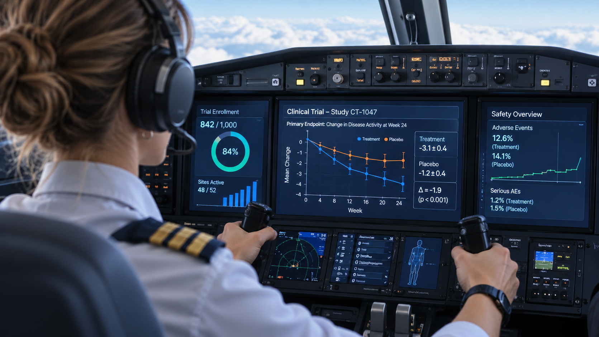

# Who Is the Human in the Loop?

*By Andrea Grioni*

---

There is an easy way to add AI to a clinical trial. Let the system draft the answer to a site query, the summary of an adverse event or the reconciliation of a dataset, and put a person at the end with a single button: *Approve*.

It looks responsible. I have come to think it is the wrong design.

In my [previous article](story.html?file=docs/AG016_clinical_trial_future.md), I argued that much of the manual, repetitive work of running a trial will move into the background, with people stepping in where judgement is needed. I ended with a question we are not asking enough. We talk a lot about keeping a "human in the loop". We talk far less about who that human is, what they have been trained to judge, and what they can realistically check.

This article is my attempt at an answer.

## A new layer, or a new flow?

Imagine the AI is right 98% of the time. After fifty correct answers, the fifty-first gets less attention. Not out of carelessness, but because that is how attention works. Aviation and radiology have studied this for years under the name *automation bias*: when a system is usually right, people stop looking for the moments it is wrong.

A reviewer at the end of the chain who cannot realistically catch the 2% is not a safeguard. They are a signature. And the organisation now has one more step, one more queue and one more handover than before. AI has become a new layer of complexity rather than a way of removing it.

The alternative is to stop thinking of AI as something we bolt onto existing processes, and start thinking of end-to-end workflows that are led by experts and enabled by AI. In that design, the AI does the job: it retrieves, extracts, reconciles and drafts. The human does not sit at the end approving outputs. They own the workflow. They decide what question it answers, where its limits are, which cases need a closer look, and what happens when something doesn't fit.

At BioTechX, I heard this put more sharply than I could have put it myself: not a human *in the loop*, but a human *in the lead*. A checkpoint reacts to what the system produces. A lead decides what the system is for.

## What that human must be able to do

If the expert owns the flow, what do they actually need? The clearest way I have found to describe it is to start from how AI systems fail.

**They can be fluent but wrong.** A summary describes an adverse event as non-serious, while the narrative mentions a hospitalisation. It is exactly the kind of cross-check I described in an [earlier article on data quality](story.html?file=docs/AG012_DS_AI_Aut_clinical_trials.md). Catching it takes clinical understanding: the sense that something is implausible, even when it reads well.

**They can be incomplete.** An extracted list of events is missing a change in concomitant medication. Nothing on the page is wrong; something is simply absent. Catching this takes knowing what *should* be there.

**They can rest on the wrong source.** An answer cites version 3 of the protocol, but amendment 4 changed the rule. Catching this takes awareness of how trial documents evolve.

**They can answer the wrong question.** A site asks about a visit window, but the real issue is eligibility. My line manager often reminds me that asking the right question is one of the most important skills in clinical development. With AI it matters even more, because a system will confidently answer whatever it is asked.

What strikes me is that none of these is a technical skill. As tools change faster than any of us can keep up with, the behaviours matter more than the tools: **curiosity** to experiment with a system and find where it breaks, **critical thinking** to challenge what it produces, and **human judgement** to decide what happens next and to own that decision. When a health authority asks why something happened, they ask a person, not a model.

## Two ways judgement erodes

Here is the tension. The more work AI takes on, the more we depend on human judgement. And the less routine work people do, the fewer opportunities they have to build it.

**Experienced people can lose it.** A trial leader who spends years only overseeing AI output may slowly lose some of the instinct that made them good at it. Aviation knows this well: pilots who rely heavily on autopilot need deliberate practice to keep their manual flying sharp.

**New people may never acquire it.** A junior colleague who never digs through a protocol to answer a site query never learns what it feels like when something doesn't fit. Judgement is largely built by doing the routine work, which is precisely the work being automated.

The first is a problem of maintenance. The second is a problem of apprenticeship.

## Judgement is built together

The good news is that judgement has never been built alone. It is built in teams, in escalations, in the conversations where someone more experienced explains not just what they did but why. Clinical development is a community before it is a set of processes, and that is exactly where the answer lies.

**Learn from every miss, together.** When the AI gets something wrong and someone catches it, that case is valuable. It should be shared and discussed across teams, not quietly closed.

**Design the apprenticeship.** New colleagues could work a task by hand before they lead the workflow that automates it, long enough to know what good looks like and where the traps are.

**Keep experts in practice.** Some cases could be worked through in full rather than overseen, the way pilots keep flying by hand. It looks inefficient. It is closer to maintenance.

**Make answers traceable.** People can only judge what they can trace. Systems that point to the exact passage, document version and context make judgement possible. A fluent paragraph without sources makes it decorative.

**Value cross-exposure.** My rotation from biomarker development into clinical development, which I described in [Driven by Curiosity](story.html?file=docs/AG011_Driven_by_Curiosity.md), taught me more about judgement than any course could. As I put it in [Learning to Think Like a Clinical Development Professional](story.html?file=docs/AG014_clinical_development.md), a data scientist's reflex is to trust the data pipeline; a clinical developer's reflex is to audit the human chain that feeds it. Seeing the same trial from different sides is how you learn which questions matter, and a human in the lead needs exactly that breadth.

## Why it matters

Underneath the systems and processes, every clinical trial is a controlled experiment that asks one question: does the medicine work better than the standard of care? As I [wrote previously](story.html?file=docs/AG015_EUNL_meeting.md), everything else exists to protect the integrity of that question. The answer often rests on a narrower margin than we think, and every missed piece of the picture matters to the patients and families waiting for it.

AI can help us get to that answer faster and with less complexity for patients, sites and colleagues. But only if it gets the job done, rather than adding one more layer to check.

So, who is the human in the loop? Not the person pressing *Approve*. It is the human in the lead: the expert who owns the work, supported by a community that keeps their judgement sharp. The real opportunity is not another technology layer, but simplifying how we work end to end, with expertise and judgement at the centre.

How is your team approaching this? Are you designing how people build judgement, or assuming it will still happen on its own?

---

*Author's Note: The views expressed here are my own and do not represent the position of Novartis or any of its affiliates.*

*For further details or to get in touch, visit my [personal page](https://andreagrioni.github.io/) or connect on [LinkedIn](https://www.linkedin.com/in/agrioni/).*
