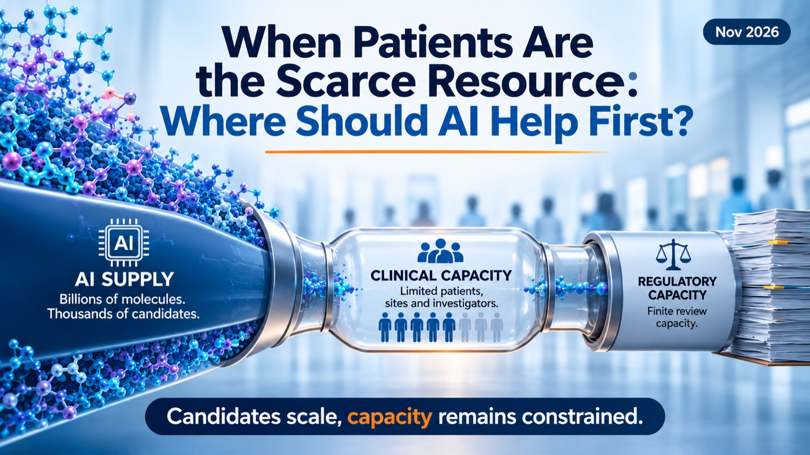
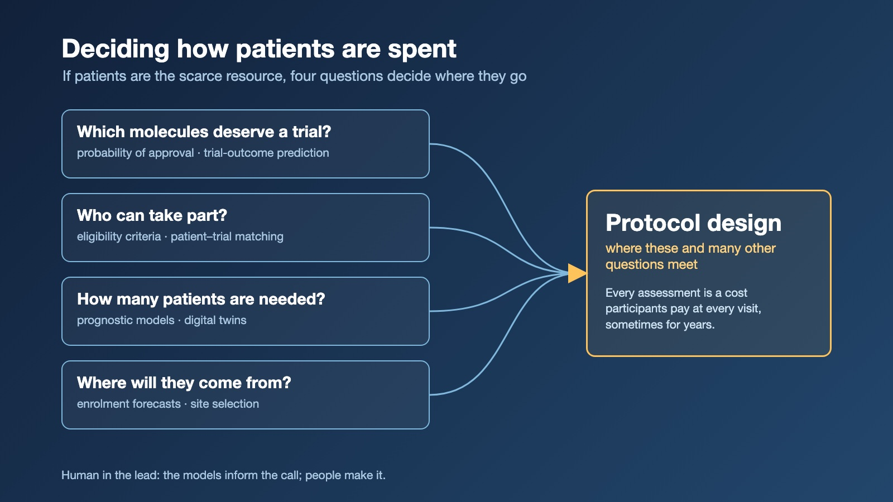
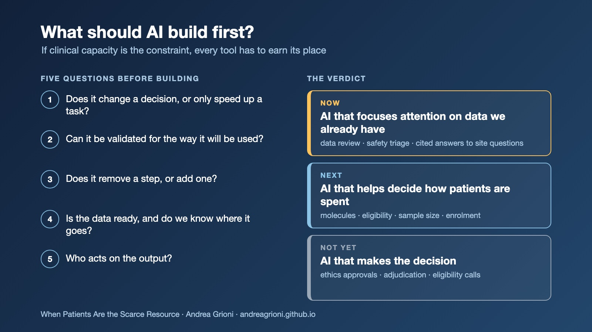

# When Patients Are the Scarce Resource: Where Should AI Help First?

*By Andrea Grioni*

---

At the [Festival of Biologics](https://www.terrapinn.com/conference/festival-of-biologics/index.stm) in Basel this October, a speaker from Massachusetts General Hospital showed a slide with three columns. The first was AI supply: models that can evaluate around a billion molecules and put forward thousands of candidates. The second was clinical capacity: the patients, sites and investigators needed to test them. The third was regulatory load: the evidence every one of those candidates will eventually need. The slide's summary fitted on a single line: candidates scale, capacity remains constrained.

It is the slide I have thought about most since. If AI keeps filling the top of the pipeline faster than trials can test what it finds, the bottleneck moves to the clinic. And then the most valuable AI in pharma over the next few years may not be the AI that finds molecules. It may be the AI that helps the clinic absorb them, and helps decide which of them deserve its patients.

It is worth being precise about what AI has proven. As far as I can find, no drug whose target and molecule were both discovered with AI had been approved by late 2026; the most advanced, a generative-AI-designed molecule for idiopathic pulmonary fibrosis ([Xu et al., 2025](https://doi.org/10.1038/s41591-025-03743-2)), only entered Phase 3 this year ([NCT07687459](https://clinicaltrials.gov/study/NCT07687459)). AI-discovered molecules have so far done better than average in Phase 1, but not in Phase 2 ([Jayatunga et al., 2024](https://doi.org/10.1016/j.drudis.2024.104009)). AI seems to help most with molecules that behave well in the body; whether they work, only trials can tell. That is one more reason the bottleneck sits in the clinic.

The capacity problem is not new: depending on the field and the definition, between a fifth and a half of trials fall short of their recruitment targets ([ESMO Open, 2024](https://doi.org/10.1016/j.esmoop.2024.103603); [ASH, 2024](https://ash.confex.com/ash/2024/webprogram/Paper207446.html)). What is new is that the pressure on that capacity is about to rise.

So the question is a product question, not a technology question: if clinical capacity, and above all patients, is the constraint, where should AI help first?

## What is being built

At [BioTechX](https://www.terrapinn.com/conference/biotechx/index.stm) this autumn, pharma companies, technology providers and academic groups showed tools aimed at exactly this problem. Three examples stayed with me.

- **Ethics review.** AI that organises a trial submission and highlights possible gaps before the ethics committee looks at it. The committee still reviews and decides. No automated approvals or rejections.
- **Clinical data review.** Agentic AI in clinical data workflows, taken from proof of concept to GxP validation. The system checks data, highlights discrepancies and summarises the evidence; clinical experts interpret it and decide what to do.
- **Pharmacovigilance.** A signal management assistant that lets reviewers ask plain-language questions of safety data, such as whether two cases are duplicates, with an expert confirming every conclusion.

Regulators point the same way: judge an AI model's credibility for a specific context of use ([FDA draft guidance, 2025](https://www.fda.gov/regulatory-information/search-fda-guidance-documents/considerations-use-artificial-intelligence-support-regulatory-decision-making-drug-and-biological)), keep the approach human-centric and talk to regulators early wherever AI could affect benefit–risk ([EMA, 2024](https://www.ema.europa.eu/en/documents/scientific-guideline/reflection-paper-use-artificial-intelligence-ai-medicinal-product-lifecycle_en.pdf)), and keep oversight proportionate to risk ([ICH E6(R3), 2025](https://database.ich.org/sites/default/files/ICH_E6%28R3%29_Step4_FinalGuideline_2025_0106.pdf)).

Each of these solves a real problem. But a portfolio is not a list of good ideas: the capacity to build, validate and support AI tools is limited too. It is the same constraint, one level up.

## Five questions before building

When I think about what belongs on a roadmap, these are the questions I come back to.

**1. Does it change a decision, or only speed up a task?** In my own talk at the same festival, on running a large cardiovascular outcomes trial, I used an illustrative example. "98% of visits on time" across a whole trial looks reassuring, and it tells you nothing about where to act. A site where 3 of 10 participants are more than a month overdue has the worse rate. A site where 20 of 100 are overdue has the greater burden. A tool that reports rates faster saves time. A tool that shows where the burden is changes where a monitor goes next week. The second is worth more.

**2. Can it be validated for the way it will be used?** A demo answers "can it work?". A GxP system has to answer "can we show it works, for this purpose, every time?". The distance between the two is where most pilots stall, and it is why the context-of-use framing in the FDA draft is useful: it forces you to define the job before you judge the tool.

**3. Does it remove a step, or add one?** As I argued in [Who Is the Human in the Loop?](story.html?file=docs/AG017_human_in_the_loop.md), an AI output followed by a person pressing *Approve* is often one more layer, not one less. The tools worth scaling replace part of a manual process and leave the expert owning the flow.

**4. Is the data ready, and do we know where it goes?** At BioTechX, the conversation had moved on from last year's focus on FAIR data to governance and AI-ready systems. Whether a model runs inside your own environment or as a provider's service, data protection depends on the set-up and the contract. That is a product decision as much as a technical one.

**5. Who acts on the output?** AI narrows the field of attention; it does not deliver the intervention. In a global trial, the global team sets priorities, country teams support the sites, and site teams follow up with each participant. If a tool's output does not fit into that chain, it will be admired and then ignored.

## Now, next, not yet

**Now: AI that focuses attention on data we already have.** Data review, deviation patterns, safety triage, and answers to site questions that point to the exact passage in the current protocol, as I sketched in [Who Will Run the Clinical Trial of the Future?](story.html?file=docs/AG016_clinical_trial_future.md) I first described this kind of quality layer in [Learning to Think Like a Clinical Development Professional](story.html?file=docs/AG014_clinical_development.md). The data exists, every output can be checked against its source, and the gain is capacity: expert time moves from searching to judging.

**Next: AI that helps decide how patients are spent.** If patients are the scarce resource, the most valuable AI may be the AI that helps decide where they go. That decision runs through four questions, and each already has published work behind it.

- *Which molecules deserve a trial?* Machine-learning models trained on past development programmes estimate the probability that a drug will be approved ([Lo et al., 2019](https://doi.org/10.1162/99608f92.5c5f0525)) or that a trial will succeed ([Fu et al., 2022](https://doi.org/10.1016/j.patter.2022.100445)).
- *Who can take part?* Using real-world data, researchers showed that relaxing several common eligibility criteria in lung cancer trials could roughly double the number of eligible patients with little change in the estimated treatment effect ([Liu et al., 2021](https://doi.org/10.1038/s41586-021-03430-5)). Large language models can now help match patients to trials from their records ([Jin et al., 2024](https://doi.org/10.1038/s41467-024-53081-z)).
- *How many patients does a trial need?* Prognostic models built on historical data, often called digital twins of trial participants, can make trials smaller without inflating the risk of a false-positive result. The EMA qualified one such method in 2022 ([EMA, 2022](https://www.ema.europa.eu/en/documents/regulatory-procedural-guideline/qualification-opinion-prognostic-covariate-adjustment-procovatm_en.pdf)).
- *Where will they come from?* Models trained on thousands of past trials predict enrolment rates ([Bieganek et al., 2022](https://doi.org/10.1371/journal.pone.0263193)) and rank sites by expected recruitment ([Hulstaert et al., 2024](https://doi.org/10.1371/journal.pone.0300109)).

Protocol design is where these questions meet, along with many others. Every assessment added to a protocol is a cost that participants pay at every visit, sometimes for years, and retention starts with study design ([The Room Where the Experiment Lives](story.html?file=docs/AG015_EUNL_meeting.md)). None of these models should make the call; each can make it better informed. This work is also harder than the "now" list: feedback loops are long, historical data carries historical biases, and the decisions it informs are among the most consequential in a programme. That is a reason to start carefully, not a reason to wait.

**Not yet: AI that makes the decision.** Ethics approvals, endpoint adjudication, eligibility calls. Not because AI could never help with them, but because accountability has to stay with a person who can explain the decision. The ethics-review example got the division right: AI prepares the package; people decide.

## Scale what works

At the same conference, a pharma venture investor described how the industry is now investing not only in medicines but in the AI tools that help develop them, following a simple sequence: identify needs, find partners, test solutions, scale what works.

Who builds is part of that decision. In *AI for Good*, Josh Tyrangiel describes how Tomas Mihaljevic, the CEO of Cleveland Clinic, sees a common way health-care organisations fail at digital transformation: keen internal staff are set loose building products of their own. "We have not developed a single product that anyone has ever used," Mihaljevic says. What has worked instead is taking problems inside the clinic to AI partners with "a relatively narrow field of focus", often smaller companies that need Cleveland Clinic more than it needs them, without ever becoming a passive customer. Clinicians work directly with the technical teams to design, test and implement, and, as Tyrangiel puts it, "Nothing gets a green light without a lengthy pilot."

Having built prototypes from inside a clinical team myself ([the first one started as a proof of concept in 2024](story.html?file=docs/AG012_DS_AI_Aut_clinical_trials.md)), I read the first failure mode as a warning rather than a verdict. A prototype built with its users is often the fastest way to understand a problem. But the prototype is not the product. Scaling needs an owner, the right partner for the job, and a path to validation, and every tool that scales takes support, training and the attention of the people who use it.

If the bottleneck is moving to the clinic, the scarce resource is not ideas for AI. It is the judgement to choose the few that deserve to scale, and the discipline to stop the rest. In [Who Will Run the Clinical Trial of the Future?](story.html?file=docs/AG016_clinical_trial_future.md), I described AI as an attention-allocation technology for clinical experts. The same holds one level up: a portfolio of AI tools is an attention problem too.

If you could scale only two AI tools in clinical development next year, which would you choose, and which would you stop?

## References

- Xu Z, et al. [A generative AI-discovered TNIK inhibitor for idiopathic pulmonary fibrosis: a randomized phase 2a trial](https://doi.org/10.1038/s41591-025-03743-2). *Nature Medicine* 2025.
- ClinicalTrials.gov. [NCT07687459: Phase 3 study of rentosertib in patients with idiopathic pulmonary fibrosis](https://clinicaltrials.gov/study/NCT07687459). Accessed November 2026.
- Jayatunga MKP, et al. [How successful are AI-discovered drugs in clinical trials? A first analysis and emerging lessons](https://doi.org/10.1016/j.drudis.2024.104009). *Drug Discovery Today* 2024.
- Villacampa G, et al. [Accrual and statistical power failure in published adjuvant phase III oncology trials: a comprehensive analysis from 2013 to 2023](https://doi.org/10.1016/j.esmoop.2024.103603). *ESMO Open* 2024;9(7):103603.
- [Analysis of Factors Influencing Enrollment Success in Hematology Malignancy Cancer Clinical Trials (2008–2023)](https://ash.confex.com/ash/2024/webprogram/Paper207446.html). Abstract, ASH Annual Meeting 2024.
- U.S. Food and Drug Administration. [*Considerations for the Use of Artificial Intelligence to Support Regulatory Decision-Making for Drug and Biological Products*](https://www.fda.gov/regulatory-information/search-fda-guidance-documents/considerations-use-artificial-intelligence-support-regulatory-decision-making-drug-and-biological). Draft guidance, January 2025.
- European Medicines Agency. [*Reflection paper on the use of artificial intelligence (AI) in the medicinal product lifecycle*](https://www.ema.europa.eu/en/documents/scientific-guideline/reflection-paper-use-artificial-intelligence-ai-medicinal-product-lifecycle_en.pdf). 2024.
- ICH. [*E6(R3) Guideline for Good Clinical Practice*](https://database.ich.org/sites/default/files/ICH_E6%28R3%29_Step4_FinalGuideline_2025_0106.pdf). 2025.
- Lo AW, et al. [Machine Learning with Statistical Imputation for Predicting Drug Approval](https://doi.org/10.1162/99608f92.5c5f0525). *Harvard Data Science Review* 2019.
- Fu T, et al. [HINT: Hierarchical interaction network for clinical-trial-outcome predictions](https://doi.org/10.1016/j.patter.2022.100445). *Patterns* 2022.
- Liu R, et al. [Evaluating eligibility criteria of oncology trials using real-world data and AI](https://doi.org/10.1038/s41586-021-03430-5). *Nature* 2021.
- Jin Q, et al. [Matching patients to clinical trials with large language models](https://doi.org/10.1038/s41467-024-53081-z). *Nature Communications* 2024.
- European Medicines Agency. [*Qualification opinion for Prognostic Covariate Adjustment (PROCOVA™)*](https://www.ema.europa.eu/en/documents/regulatory-procedural-guideline/qualification-opinion-prognostic-covariate-adjustment-procovatm_en.pdf). 2022.
- Bieganek C, et al. [Prediction of clinical trial enrollment rates](https://doi.org/10.1371/journal.pone.0263193). *PLOS ONE* 2022;17(2):e0263193.
- Hulstaert L, et al. [Enhancing site selection strategies in clinical trial recruitment using real-world data modeling](https://doi.org/10.1371/journal.pone.0300109). *PLOS ONE* 2024;19(3):e0300109.
- Tyrangiel J. *AI for Good: How Real People Are Using Artificial Intelligence to Fix Things That Matter*. Simon & Schuster, 2026. Chapter 1, "Tommy".

---

*Author's Note: The views expressed here are my own and do not represent the position of Novartis or any of its affiliates.*

*For further details or to get in touch, visit my [personal page](https://andreagrioni.github.io/) or connect on [LinkedIn](https://www.linkedin.com/in/agrioni/).*
